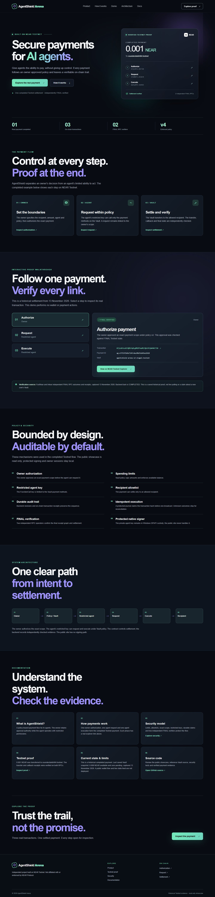

# AgentShield Arena

**Website:** https://near-agentshield-arena.vercel.app

**Public source:** https://github.com/chapaevv123/near-agentshield-arena

**Secure, policy-bound payments for AI agents on NEAR Testnet.** This independent hackathon project is not affiliated with or endorsed by NEAR Protocol.



## Why it exists

An AI agent may need to pay for a service, but unrestricted treasury credentials make mistakes and malicious instructions costly. AgentShield Arena keeps owner approval, Vault policy and agent execution separate. The owner authorizes an exact scope; a restricted FunctionCall key lets the agent request and execute only through the Vault; independent FINAL receipt checks prove the outcome.

## Real historical Testnet proof

On 13 November 2026, one policy v4 payment of **0.001 NEAR** settled from `agentshield-arena-v2-stage2.testnet` to `soundestate8404.testnet`. Owner: `safeibis9110.testnet`. Restricted agent: `openroom8315.testnet`. Task `task-ab5b09b7692e4a9d8d9d21241cb9a0d2`, payment `ag-e7f53f5b9e714fc4ac09d7eb45ee2618`.

| Step | On-chain transaction |
| --- | --- |
| Owner AUTHORIZE | [6YjcdhYxs65JQMtfqDLgMM2PfadMtJQkSfHjmR4KCT1N](https://testnet.nearblocks.io/txns/6YjcdhYxs65JQMtfqDLgMM2PfadMtJQkSfHjmR4KCT1N) |
| Agent REQUEST | [2Yo8N6TvbtobhWYH8UxvgAAxCrm1FGXduBa82qZCUmr8](https://testnet.nearblocks.io/txns/2Yo8N6TvbtobhWYH8UxvgAAxCrm1FGXduBa82qZCUmr8) |
| Agent EXECUTE | [ApXoyN7EpG6S8DFX6gfm919tqQFQC4u911MDxU7p4KdS](https://testnet.nearblocks.io/txns/ApXoyN7EpG6S8DFX6gfm919tqQFQC4u911MDxU7p4KdS) |

FastNear and Intear independently observed successful FINAL execution, transfer receipt `bhH1rHpPWmLPrWKo8dUYfQuWQxhpUNezUEEoESR1frv`, and callback receipt `2nw4yLNc1aF2MLP1thgKBUwDTWhq7fBrtnvm7qeEtVQ6`. The authenticated local backend recorded task `COMPLETED`, revision 9, evidence `TESTNET_TWO_RPC_FINAL`. See the [proof summary](docs/TESTNET_PROOF_2026-11-13.md). This is a saved historical settlement, not live polling or a new visitor's payment.

## What is in this public repository

- `app/showcase/`: responsive, read-only product site with an interactive proof walkthrough, exact explorer links, security model, architecture and documentation.
- `contract/`: reference source and security tests for the multitenant Vault. The public site does not invoke its payment methods. This snapshot does not claim byte-for-byte reproducibility of the deployed WASM.
- `docs/`: Testnet proof, desktop/mobile screenshots, demo script and submission drafts.

The protected local owner UI, NEP-413 session handling, SQLite backend, Windows DPAPI signer, native transaction sender, journals and operational runbooks are deliberately **not distributed** in this public snapshot. The site has no wallet button, signing path, local API request or secret. It does not offer public self-service payments.

## Architecture and safeguards

`Owner → Policy / Vault → Restricted agent → Request → Execute → Recipient`

The Vault enforces amount and recipient restrictions. A restricted agent key can call only payment methods. A protected local sender claims each transaction hash before one broadcast and treats ambiguous results as read-only reconciliation. The backend's audit trail and two independent FINAL RPC verifiers are distinct from the read-only site. This repository contains public source and proof without operational secrets.

## Run the public site

Requires Node.js 22+ and npm.

```sh
cd app
npm ci
npm run build:showcase
npm run preview:showcase
```

Open `http://127.0.0.1:4182`. Run `npm run test:showcase` for desktop, tablet, mobile, navigation, link and keyboard smoke tests. The Playwright configuration uses Microsoft Edge locally; if Edge is unavailable, install a compatible Playwright Chromium browser or adjust the test channel. The production site is a static Vite build; Vercel root is `app` and output is `dist-showcase`.

Run `npm run test:live` from `app/` to check the published HTTPS site in a fresh browser context, including the GitHub link, three explorer links, mobile navigation, console errors and localhost requests.

Run `python scripts/audit_publish.py` from the repository root to scan the exact public files and every reachable Git blob for sensitive paths and key/token markers.

## Known limits

The public showcase is read only. It documents one historical completed payment and a saved Vault snapshot, not current account balances or general user onboarding. Explorer availability depends on the external operator. No public backend, wallet signing or agent execution is deployed. The official NEAR symbol used in the site comes from the [Wikimedia Commons CC0 file](https://commons.wikimedia.org/wiki/File:Near_Protocol_Logo.png); AgentShield Arena is an independent project.

## Hackathon

Primary track: **AI Security & Defense**. The [NEAR Hackathon](https://near.army/) allows one submission across multiple fitting tracks; Agent Economy is a possible secondary fit because a restricted agent completed a real payment. [Demo and submission drafts](docs/HACKATHON_DEMO_SUBMISSION_2026-11-13.md) are included. No prize or endorsement is claimed.

## License

No license has been approved by the owner. All rights are reserved until one is selected.
