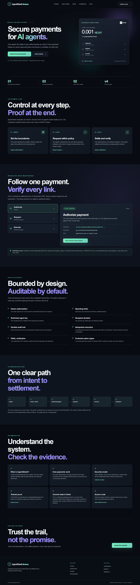

# AgentShield Arena

**Public source:** https://github.com/chapaevv123/near-agentshield-arena · **Testnet contract:** [`agentshield-arena-v2-stage2.testnet`](https://testnet.nearblocks.io/address/agentshield-arena-v2-stage2.testnet)

**Website:** https://near-agentshield-arena.vercel.app · **Release Preview:** https://near-agentshield-arena-67n5ofb6f-chapaevv123s-projects.vercel.app/app/ (Vercel sign-in required)

## WORKING NOW

- The public landing shows one **historical** 0.001 NEAR payment with independently verified FINAL receipts. The hosted Production `/app/` returned 404 in the 14 November preflight; do not treat the landing as the new payment app.
- The [Preview `/app/`](https://near-agentshield-arena-67n5ofb6f-chapaevv123s-projects.vercel.app/app/) was built from release commit `449e9f8` and is READY behind Vercel Authentication. It contains the real Meteor Testnet owner workspace: read FINAL Vault/policy, create, deposit, set recipient, authorize, revoke, withdraw and reconcile exact transaction hashes.
- The Preview also contains a **manual, unexecuted** 0.001 NEAR Vault payment route. Every state-changing step needs a separate Meteor wallet confirmation. A read-only Judge Demo estimates ALLOW/DENY; it does not transfer funds. No new payment has a verified hash or settlement receipt.

## EXPERIMENTAL

- Cloudflare Workers + D1 read-only API is code- and test-level work, not a verified public service. With no approved Worker URL, owner wallet operations use direct NEAR Testnet RPC and cloud-only panels report unavailable.
- [PR #1](https://github.com/chapaevv123/near-agentshield-arena/pull/1) carries the release candidate against the landing baseline. The Preview is a separate CLI deployment; its existence does not mean the PR was merged or Production changed.

## NOT AVAILABLE

- Autonomous agent REQUEST/EXECUTE. The Windows DPAPI signer and local control plane are outside Lite; the public Worker has no signing or broadcast route. The manual demo asks the agent's Meteor account to confirm its own calls and does not prove use of a restricted FunctionCall key.
- A new public Meteor-to-Vault FINAL payment E2E. **PRODUCT READY = NO** until the owner and agent actually sign, the contract settles, and fresh receipts are checked.

Judge path without signing: **open the Preview after Vercel sign-in → `/app/` → Connect Meteor Testnet → inspect the connected account and FINAL Vault/policy → read the fixed 0.001 NEAR manual payment steps → open the historical proof links below.** The owner must separately authorize any live Testnet transaction. If Meteor cancels, RPC fails or an outcome is UNKNOWN, stop and reconcile the exact hash before another attempt.

Exact publication gates, commands, rollback and public E2E checklist: [Lite release runbook](docs/LITE_RELEASE_RUNBOOK_2026-11-14.md).

For NEAR HACKATHON, review the new Lite work against the earlier landing baseline: [release diff](https://github.com/chapaevv123/near-agentshield-arena/compare/e633cbc...449e9f8) and [PR #1](https://github.com/chapaevv123/near-agentshield-arena/pull/1). The primary submission track is AI Security & Defense. See the [submission draft](docs/LITE_HACKATHON_SUBMISSION_2026-11-14.md); no X demo post or application is evidenced here.

**Secure payments for AI agents, with owner policy and verifiable NEAR Testnet settlement.** This is an independent hackathon project built on NEAR Testnet, not an official NEAR Protocol product.



## The problem and solution

An agent can propose a useful payment and still make a costly mistake or follow malicious instructions. AgentShield separates the owner's authority from the agent's limited ability to act. The owner approves an exact scope; a restricted agent key can request and execute only through a shared Vault contract; the recipient, limits, policy, and final receipts are checked independently.

The [showcase](app/showcase/) walks through a **completed historical Testnet payment**. The `/app/` release adds real owner wallet actions and a manual owner/agent payment path. The contract and its policy, not the browser, decide whether a transfer is allowed.

## Manual 0.001 NEAR payment in the Preview

The fixed demo uses owner `safeibis9110.testnet`, agent `openroom8315.testnet`, recipient `soundestate8404.testnet`, and Vault `agentshield-arena-v2-stage2.testnet`. The last read-only FINAL preflight found 0.009 NEAR available, policy v4 and the recipient allowed; **the agent grant had expired**. Recheck live state in `/app/` before any signature. Both wallet accounts must be available to the owner in Meteor Testnet; that has not been verified in this session.

1. **Owner — Renew Agent Grant.** First connect `openroom8315.testnet` in Meteor without signing, then switch to `safeibis9110.testnet`. Review the fresh FINAL Vault and explicitly confirm `set_agent` in Meteor. Do not repeat an active grant.
2. **Owner — Authorize Payment.** After the grant is FINAL, confirm `authorize_payment` for a new `ag-demo-…` ID, exactly 0.001 NEAR, the named agent and recipient. This records consent; **no funds move yet**.
3. **Agent — Request Payment.** Switch Meteor to `openroom8315.testnet`. The app rechecks grant, policy, one-use authorization and account identity before asking Meteor to sign `request_payment`.
4. **Agent — Execute Payment.** After REQUEST is FINAL, explicitly confirm `execute_payment` in Meteor. The UI shows `FINAL SETTLED` only after two RPCs verify the exact transaction, successful transfer and callback receipts, contract status, Vault balance and recipient balance. Open the displayed hash in Testnet Explorer.

Every step has its own wallet prompt. A cancelled prompt sends no transaction. An unknown result locks further submissions until the exact hash is reconciled. The local tests and protected Preview build do **not** prove that these four live steps have happened. Do not use the historical hashes below as evidence for this new payment.

## Real Testnet proof

On 13 November 2026, payment `ag-e7f53f5b9e714fc4ac09d7eb45ee2618` completed under policy v4: **0.001 NEAR** from Vault `agentshield-arena-v2-stage2.testnet` to `soundestate8404.testnet`, owner `safeibis9110.testnet`, restricted agent `openroom8315.testnet`.

| Phase | FINAL transaction |
| --- | --- |
| Owner authorization | [6YjcdhYxs65JQMtfqDLgMM2PfadMtJQkSfHjmR4KCT1N](https://testnet.nearblocks.io/txns/6YjcdhYxs65JQMtfqDLgMM2PfadMtJQkSfHjmR4KCT1N) |
| Agent request | [2Yo8N6TvbtobhWYH8UxvgAAxCrm1FGXduBa82qZCUmr8](https://testnet.nearblocks.io/txns/2Yo8N6TvbtobhWYH8UxvgAAxCrm1FGXduBa82qZCUmr8) |
| Settlement execution | [ApXoyN7EpG6S8DFX6gfm919tqQFQC4u911MDxU7p4KdS](https://testnet.nearblocks.io/txns/ApXoyN7EpG6S8DFX6gfm919tqQFQC4u911MDxU7p4KdS) |

FastNear and Intear independently confirmed the exact FINAL execute outcome, transfer receipt `bhH1rHpPWmLPrWKo8dUYfQuWQxhpUNezUEEoESR1frv` and callback receipt `2nw4yLNc1aF2MLP1thgKBUwDTWhq7fBrtnvm7qeEtVQ6`. The backend task `task-ab5b09b7692e4a9d8d9d21241cb9a0d2` is `COMPLETED` at revision 9 with `TESTNET_TWO_RPC_FINAL` settlement evidence. See [proof details](docs/TESTNET_PROOF_2026-11-13.md). This proof describes one historical payment, not a new user's live Vault.

## Product features

- Exact owner authorization, recipient allowlist, payment limits and grant expiry enforced by the NEAR Testnet Vault.
- Meteor wallet confirmation for owner actions and the manual agent request/execute candidate in `/app/`.
- One-use payment IDs, local pending-operation lock, FINAL RPC reconciliation and two-provider receipt checks in the manual flow.
- Historical restricted FunctionCall key settlement and audited local backend proof, separate from the new manual candidate.

## Architecture and security

Historical restricted-key path: `Owner → Policy / shared Vault → Restricted agent → Request → Execute → Recipient`. The current Preview's manual path switches between owner and agent Meteor accounts; it does not claim restricted-key custody or autonomous execution.

The shared Testnet Vault contract enforces payment policy. The protected historical agent signer and journal remain outside the public release on a local Windows host. Neither the public build nor this repository's publication set contains private keys, bearer tokens, SQLite databases, DPAPI stores or journals. The read-only showcase performs no signing; `/app/` requests separate Meteor confirmation for each supported on-chain action.

`contract/` contains the earlier single-owner contract, not the deployed shared Vault v2 source. The isolated multitenant experiment remains outside this publication set and has incompatible Borsh state; never deploy it onto the historical Vault or a personal account. The app pins the deployed Testnet contract code hash and genesis before signing. [Proof details](docs/TESTNET_PROOF_2026-11-13.md) record the historical receipt evidence.

## Tech stack and local run

- Frontend: React 19, TypeScript 5, Vite 7; Playwright browser checks.
- Contract interface: NEAR Testnet Vault v2 at `agentshield-arena-v2-stage2.testnet`; this public snapshot also contains an earlier Rust / NEAR SDK contract for reference.
- Hosting: Vercel Preview for the current wallet workspace. Cloudflare Worker + D1 is an optional, unverified read-only cloud API; the manual wallet route uses direct NEAR RPC.

Requirements: Node.js 22, npm; Python 3.11+ for the release scans. Meteor Wallet with the intended **Testnet** account is needed for wallet prompts.

```sh
cd app
npm ci
npm run build:showcase
npm run preview:showcase
```

Open `http://127.0.0.1:4182` locally. The Vercel project root is **`app`**; `app/vercel.json` runs `npm run build:showcase` and publishes `dist-showcase`, including `/app/`. A local build is not evidence of a signed Testnet action.

## Checks

```sh
cd app
npm test
npm run build:showcase
npx playwright test --config playwright.showcase.config.ts
```

From the repository root:

```sh
python tools/scan_public_secrets.py
python tools/audit_git_publication.py
git diff --check
```

Start `npm run preview:showcase` in another terminal before Playwright. The tests use Microsoft Edge and may update the checked-in [desktop](docs/screenshots/desktop.png) and [mobile](docs/screenshots/mobile.png) screenshots; restore those generated files if they were not intentionally changed. Browser tests use no live wallet signature.

## Limits and publication

As checked on 14 November 2026, Production still served the earlier landing and `/app/` returned 404. The current `/app/` candidate is deployed only to the protected Preview above; anonymous HTTP receives Vercel SSO redirects. Public Production rendering, both Meteor accounts, new signatures and a new FINAL payment remain unverified. Autonomous cloud agent signing is unavailable.

The original development checkout retains extensive uncommitted work. The release branch isolates the public subset. Review the [release runbook](docs/LITE_RELEASE_RUNBOOK_2026-11-14.md) and [hackathon diff](https://github.com/chapaevv123/near-agentshield-arena/compare/e633cbc...449e9f8) before using the repository as submission evidence.

## Hackathon

Recommended primary track: **AI Security & Defense** (`security`) under the [official instructions](https://nearhackathon.com/HACKATHON.md). The owner decides any additional track after reviewing the independently verified historical agent payment and the current public limitations. The [submission draft](docs/LITE_HACKATHON_SUBMISSION_2026-11-14.md) is for owner review; no X post or application has been sent.

## License

No license has been approved. All rights remain with the repository owner until a license is selected and added.
